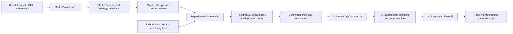

# V3.4 architecture

This is a single EUR paper account with EUR 500 virtual funding. No exchange trading credentials or live-order adapter exist.

`worker.runner.main` runs discovery/allocation and a separate protective monitoring task in ordinary operation. Acceptance replay uses the same services with an explicitly test-only file adapter. PostgreSQL contains positions, targets, pending intentions, reservations, circuit states, cooldowns and AI budgets. Redis is internal and health-checked; it is not the accounting authority.

`backtest.Backtester` invokes the scanner, gateway, manager and repository against an isolated replay database. `PaperBroker` is a synchronous compatibility facade over that repository. `Portfolio` is a projection used for deterministic risk evaluation; it cannot post unpersisted fills.

Alembic migrations precede readiness. The image includes migration sources, and the migration service gates API and worker startup. See the execution tracker for the precise verification status of each requirement.
