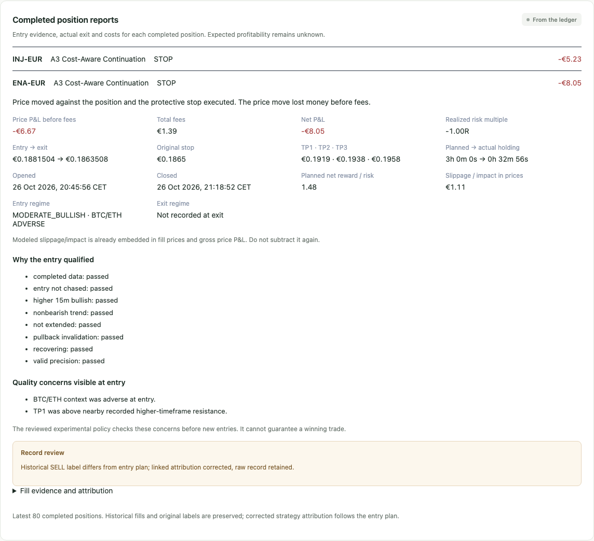

# V4.7.1 loss investigation and engineering report

The two prospective paper positions lost **€13.288009175286**, leaving **€6,986.711990824714**. Both followed their original protective stops. Neither was closed by a regime reversal, failed-breakout rule, target or time expiry. The SELL labels were wrong; the stop triggers and journal arithmetic were correct. Positive net expectancy has **not** been demonstrated.

This work is Mac-only and virtual. It preserves the original funding, losses, raw executions, account origin, official €500 account and both research shadows. No exchange mutation, VPS access, production configuration change or immutable release tag is authorized or performed.

## Actual ENA and INJ reconstruction

All timestamps below are UTC on 26 October 2026. Exact records, books, execution-quality payloads, original strategy evidence, intents and linked reports are in [loss-audit.json](evidence/v4_7_1/loss-audit.json). The private original PostgreSQL export and raw worker logs remain under `.tools/v47_1`.

| Recorded fact | ENA-EUR | INJ-EUR |
|---|---:|---:|
| Entry strategy | A3 Cost-Aware Continuation | A3 Cost-Aware Continuation |
| Signal candle start; completed by | 19:40; 19:45 | 20:45; 20:50 |
| Position opened | 19:45:56.038860 | 20:50:36.305959 |
| Quantity | 3704.879800000000 | 97.524140000000 |
| BUY VWAP | €0.188150400000 | €7.147713600000 |
| Entry gross notional | €697.074616321920 | €697.074621806304 |
| Entry fee | €0.697074616321 | €0.697074621806 |
| Entry total debit | €697.771690938241 | €697.771696428110 |
| Entry bid / ask | €0.1877 / €0.1880 | €7.129 / €7.142 |
| Entry spread | 15.97018898 bps | 18.21876533 bps |
| Entry book age at fill | 3.152856 s | 0.386188 s |
| Entry bid / ask base depth | 2276360.2319 / 2242277.1227 ENA | 27531.059028 / 26355.030223 INJ |
| Original stop | €0.1865 | €7.116 |
| TP1 / TP2 / TP3 | €0.1919 / €0.1938 / €0.1958 | €7.277 / €7.345 / €7.413 |
| Conditional TP1 net gain, estimated at €700 budget | €11.953623823355424 | €10.6685695467613064 |
| Estimated net stop risk at €700 budget | €8.08050627997296 | €5.0546185226670688 |
| Estimated net reward / risk | 1.4793161974 | 2.1106577082 |
| Estimated round-trip cost at €700 budget | €3.628477368122 | €3.785044330725 |
| Planned maximum holding | 10800 s (3 hours) | 10800 s (3 hours) |
| Exit intent reason and creation | STOP; 20:18:52.476407 | STOP; 21:04:58.422884 |
| Position closed | 20:18:52.501951 | 21:04:58.443268 |
| Exit fresh bid / ask | €0.1865 / €0.1868 | €7.114 / €7.131 |
| Exit book age at fill | 0.083276 s | 0.143908 s |
| SELL VWAP | €0.186350800000 | €7.108308800000 |
| Exit gross proceeds | €690.407314633840 | €693.231702574432 |
| Exit fee | €0.690407314633 | €0.693231702574 |
| Exit net credit | €689.716907319207 | €692.538470871858 |
| Price P&L before fees | −€6.667301688080 | −€3.842919231872 |
| Total fees | €1.387481930954 | €1.390306324380 |
| Net realized P&L | **−€8.054783619034** | **−€5.233225556252** |
| Modeled slippage / impact embedded in prices | €1.109981988080 | €1.112243311872 |
| Actual-size initial net stop risk | €8.05478361903484 | €5.038528207117808 |
| Realized R against actual-size initial risk | approximately −1.0000R | −1.0386417107R |
| Actual holding | 1976.463091 s (32m56s) | 862.137309 s (14m22s) |

Both sides filled at the observed top level with **zero modeled depth impact**, 8 bps adverse slippage per side and 10 bps taker fees. Spread is already represented by buying at ask and selling at bid. Slippage is already in the VWAP and gross price P&L; it must not be subtracted a second time. Gross losses total €10.510220919952 and fees €2.777788255334.

ENA's moderate bullish trend and INJ's strong bullish trend passed all original A3 checks: completed data, valid precision, non-bearish local trend, bullish completed 15-minute context, recovery/reclaim, valid pullback structure, extension below the existing limit and no excessive distance from the current ask. Both had healthy observed liquidity and normal volatility. ENA's structure was compression/ranging; INJ's compression/trending. The recorded completed hourly context was bullish for both.

However, synchronized BTC/ETH context was **ADVERSE for both**, and their first targets lay above known overhead resistance: ENA TP1 €0.1919 versus €0.19 on both higher horizons; INJ TP1 €7.277 versus nearest 15-minute resistance €7.187 (hourly €7.3). The old engine used an ATR-based plausible ceiling and did not veto these combinations for A3. These are entry-quality weaknesses and new testable hypotheses, not proof that every such trade must lose. The available records do not establish systematic late entry or excessive chasing; the existing anti-extension checks passed. The initial stops were approximately 1.63 and 1.42 primary ATR from executed entry, so a universally too-tight stop is not established by these two samples.

ENA exited when its bid equaled the original stop. INJ's observed bid crossed €0.002 below its stop, explaining the additional loss beyond −1R. Neither reached a target. The three-hour holding limit is a maximum, not a promise to ignore invalidation for three hours; `holding_seconds` correctly takes precedence over the older 24-hour fallback field. Delaying these stops to force the intended holding period would change the risk policy without evidence.

A transient ENA future-book protection warning at 19:47:46 is retained in the incident history. The system rejected that invalid observation rather than fabricating a fill. The eventual stop used the fresh book shown above. The data do not establish that this transient warning caused the loss. A position-specific exit-regime assessment was not stored at either actual exit; the UI explicitly says it is unavailable rather than inventing one.

## Confirmed defects and corrections

**SELL attribution.** Automatic exits have no BUY decision ID, so accounting previously fell back to `ensemble-v3.4`. The original ExitPlan already identified A3. New SELL payloads inherit the position's original plan, entry evidence, execution profile and entry order ID. Existing executed payloads are untouched. Dashboard/Activity order and fill projections link the original entry plan, expose the raw label and disclose historical correction. The historical raw `ensemble-v3.4` values remain available in both reports.

**Shared feature dependence.** The old `market_exit_reason(symbol)` chooses a latest shared feature without a position/strategy identity, timeframe or quality check, and allows future-dated feature timestamps. The personal-paper coordinator also wrote strategy-derived regime metadata into a shared market feature. This is a latent causal defect; a deterministic regression reproduces an unrelated bad-quality, one-minute BEAR feature authorizing the old `regime_exit`. It did **not** cause either actual loss, whose intents say STOP.

The primary account now uses `position_exit_reason(position_id, symbol, book_time)`. It independently reconstructs contiguous, completed five-minute observations, checks freshness and source, and consults the actual position's strategy and entry breakout level. A discretionary trend exit requires two fully post-entry bearish candles plus a completed bearish 15-minute context. B3 failed-breakout exits require two post-entry closes below that position's recorded breakout level with an ATR buffer. A3 cannot inherit an unrelated strategy's failed breakout. Unknown, incomplete, stale, wrong-source or conflicting context cannot authorize a discretionary exit. Position-specific assessments are append-only and include the causal data hash and timestamps.

Stops remain first, and emergency/time-expiry policies remain active before discretionary context. Missing discretionary context can delay a discretionary reduction but cannot disable bid stops or emergency liquidation. Held coins are refreshed in the scan task even when absent from the current shortlist; the independent protection loop does not wait for candle downloads. Legacy accounts retain their original exit policy through a repository hook; frozen strategy files and bridges are unchanged.

**Entry and ranking policy.** Profile `4.7.1-paper.1` adds a fixed wrapper around the original A3/B3/E3 hypotheses, leaving their parameters and risk caps unchanged. It requires synchronized supportive/mixed benchmarks, bullish continuation, completed bullish hourly context for A3/E3, TP1 within nearest observed higher-timeframe overhead resistance, conditional TP1 net gain at least twice estimated round-trip cost, and stop distance at least one primary ATR. Missing evidence fails closed. All six named gates and their version are checked again at financial admission. These hypotheses were registered before the new interval's results were inspected; they are experimental and may reject profitable opportunities.

Eligible candidates rank by clipped conditional net reward/risk × conditional net gain/cost × remaining strategy-capital fit. The technical score breaks ties; activity and recent P&L do not set priority. These are conditional payoff measures, **not expected value or a calibrated probability**. The locked ledger continues to enforce the reserve, per-trade stop budget, drawdown, simultaneous positions, daily/weekly loss caps and correlated/strategy concentration limits.

The read-only forward audit found **251 evaluations per strategy** before this revision: A3 had 10 technical and 3 economic qualifiers, three BUY orders (including one rejected PEPE attempt) and two filled BUYs; B3 and E3 had zero qualifiers. There were **zero symbol/candle observations with multiple eligible strategies**. Therefore these actual A3 entries were not caused by A3 winning a competing ranking. The prior score-first ranking was still inadequate for comparative future opportunities and has been corrected without claiming a comparative A3 edge. See [ranking-before.json](evidence/v4_7_1/ranking-before.json).

## New historical evidence and alternatives

The earlier V4.7 study's April–October 2026 data are already examined and are not independent proof. This study acquired genuine public Coinbase EUR OHLCV for **1–31 January 2025**, a new interval for this project, in a separate immutable cache. It contains 8928 BTC, 8924 ETH and 8916 SOL five-minute bars; missing bars are not filled synthetically. Higher bars aggregate complete constituent groups only. The fixed current liquid universe introduces survivorship selection.

Predeclared training: Jan 4–10; validation: Jan 12–20; sealed test: Jan 22–31. Jan 11 and Jan 21 provide 24-hour purges. Earlier data warm features without contributing trades. The 1-hour EMA200 needs more than the initial three days, so early hourly training lacks full readiness and has few/no closed trades; missing features are not fabricated. Completed-context calculations exclude future bars. Future-append invariance is regression-tested.

There are **17 fixed variants and 68 segment/cost runs**. Normal execution assumes 10 bps fees, 8 bps slippage and 10 bps spread; stress uses 15/12/20 bps. These are finite-volume, conservative bar-model assumptions with no historical L2 or known intrabar path. The simulator uses a €500 account and €75 proposed orders, not the €7,000 prospective portfolio. The reviewed variants are **entry-policy ablations under the unchanged historical exit simulator**. New position-specific discretionary exits are tested separately, and all four actual fills replay exactly with unchanged stop priority. This is not a full historical backtest of the new runtime.

| Variant | Horizon | Training net € | Validation net € | New test net € | Test closed | Stress test net € | Stress closed |
|---|---|---:|---:|---:|---:|---:|---:|
| A3-original | 5m | -2.32 | -9.99 | -12.85 | 34 | -11.17 | 14 |
| B3-original | 5m | 0.76 | -0.84 | -1.16 | 4 | 0.00 | 0 |
| E3-original | 5m | -0.83 | -1.80 | -2.60 | 4 | -2.27 | 2 |
| A3-reviewed-policy | 5m | 0.00 | -2.49 | 0.00 | 0 | 0.00 | 0 |
| B3-reviewed-policy | 5m | 0.00 | 0.00 | 0.00 | 0 | 0.00 | 0 |
| E3-reviewed-policy | 5m | 0.00 | 0.00 | 0.00 | 0 | 0.00 | 0 |
| A3-reviewed-pullback-IOC | 5m | 0.00 | -1.02 | 0.00 | 0 | 0.00 | 0 |
| B3-reviewed-retest-IOC | 5m | 0.00 | 0.00 | 0.00 | 0 | 0.00 | 0 |
| E3-reviewed-longer-horizon | 5m | 0.00 | 0.00 | 0.00 | 0 | 0.00 | 0 |
| A_TREND_PULLBACK | 15m | -10.09 | -20.15 | -8.82 | 49 | -18.93 | 44 |
| C_BREAKOUT_RETEST | 15m | -1.65 | -7.18 | -5.23 | 19 | -6.41 | 13 |
| E_RELATIVE_STRENGTH | 15m | 0.00 | -5.85 | -12.81 | 13 | -15.22 | 13 |
| F_MEAN_REVERSION | 15m | -1.75 | -6.48 | -5.57 | 23 | -8.51 | 17 |
| A_TREND_PULLBACK | 1h | -0.62 | -31.93 | -19.81 | 28 | -25.53 | 27 |
| C_BREAKOUT_RETEST | 1h | 0.00 | -5.09 | -4.10 | 5 | -5.11 | 5 |
| E_RELATIVE_STRENGTH | 1h | 0.00 | -10.40 | -8.46 | 14 | -11.24 | 14 |
| F_MEAN_REVERSION | 1h | 0.00 | -1.36 | -6.79 | 7 | -8.39 | 7 |

All test cells above end flat. The reviewed A3 policy had three losing validation positions (−€2.49); its pullback IOC alternative had two (−€1.02). Their new test intervals had no trades. B3/E3 reviewed variants also had no new test trades. Zero exposure with zero P&L is **no evidence of positive expectancy**. None of the active original strategies or longer-horizon alternatives demonstrated a profitable new test result. Higher cost can remove eligible trades, so stress P&L is not a matched fixed-fill fee subtraction; for example stressed B3 takes zero trades.

No longer-horizon winner is promoted. A longer hold is not presumed better. No thresholds were retuned after these results. The full registration, dataset hashes, all split results, rejection counts, drawdowns, fees and stress outputs are linked in [research-registration.json](evidence/v4_7_1/research-registration.json), [research-data.json](evidence/v4_7_1/research-data.json) and [research-results.json](evidence/v4_7_1/research-results.json). The UI labels the comparison historical and unvalidated.

## Financial integrity and UI

New entries were paused while the protective worker continued running. Four financial databases were backed up using exported repeatable-read PostgreSQL snapshots, with snapshot-owned row hashes. Every dump was restored into an isolated internal Docker network and checked read-only for full financial seals, account identity, one funding event and reconciliation. No source database was restored. The candidate image then repeated reconciliation against all four restored domains and rehearsed the explicit revision against the real losing account's clone, preserving €6,986.711990824714, five orders, four fills and the original origin marker. See [financial-before.json](evidence/v4_7_1/financial-before.json) and [candidate-clone.json](evidence/v4_7_1/candidate-clone.json).

The real cutover uses the existing explicit flat/paused/reconciled revision mechanism, appending a new immutable profile and retaining the original account origin, parent hash, journal and strategy histories. A separate activation script deliberately leaves entries paused for fresh monitoring and reconciliation checks before resume. No immutable fingerprint check is bypassed and no new funding is posted.

Completed-position reports are available in Dashboard and Activity. They explain the entry conditions and known concerns, actual exit reason, planned/actual holding, prices, original stop/targets, gross P&L, exact fees, modeled slippage/impact, net P&L and actual-size realized R. Missing old exit regime information is explicit. Raw SELL labels remain visible beside the corrected linked strategy. The existing Personal Plan design, coin chart interaction and persistent signed-cookie login are retained.

The header's primary health now uses the €7,000 account's own runtime, risk, reconciliation, control and freshness checks. Official/legacy health is shown separately; incompatible historical shadows keep their own entries blocked and their histories intact. Their warnings cannot turn a healthy primary account red.

## Costs, benefits and remaining risks

- Correct attribution fixes future strategy analytics; the historical correction is a projection and does not manufacture different executions or erase losses.
- Causal exits remove shared-record contamination. Two confirmations reduce noise but may exit later on a genuine reversal; protective stops still bound the intended risk, with gap/liquidity risk remaining.
- Entry guards reject the two observed weak configurations using entry-time facts. They can miss valid breakouts and may produce very few trades; minimum frequency is not a target.
- Conditional payoff ranking favors usable cost headroom and portfolio fit. It does not estimate future success, and scan-time ranking still depends on observed liquidity and incomplete market evidence; locked admission is authoritative.
- Historical proxy results do not establish prospective Revolut X returns. Repeated research, small sample size, survivorship, unavailable L2, changing liquidity and uncalibrated signals prevent a validated profitability claim.

## Forward evidence plan

Keep the reviewed profile experimental. Freeze its manifest/parameters and evaluate fresh real Revolut X observations without synthetic trades, relaxed limits or automatic parameter promotion. Record every eligibility gate and actual finite-depth fill. Review net outcomes by profile, strategy, asset, entry regime and time, including non-trades, rejects, fees, slippage, drawdown, realized R, exit consistency and capital utilization. Continue comparing with explicitly separate chronological research identities; reserve new intervals before inspecting results and count every tested variant. Do not call 30 trades independent samples or claim a completed 30-day test.

If data, reconciliation, identity or protective monitoring fails, suspend entries and preserve diagnostics. A future strategy change needs its own reviewed version, chronological evidence and explicit migration; a real-money phase remains separately unauthorized. Engineering acceptance and a running worker establish operational integrity only. A credible positive-net-expectancy claim requires future evidence that is currently absent.

## Verification and actual Mac activation

- Full PostgreSQL-backed backend suite: **302 passed**, one upstream Starlette/AnyIO deprecation warning, no failures (683.13 seconds). Updated admission/future-context/session regressions also passed separately: **11 passed**.
- Ruff passed; mypy checked **109 source files** with no issues. Frontend production build passed; **19 frontend unit tests** passed.
- Current UI browser set: **34 passed**. Explicit read-only tests against the persistent real Mac server: **2 passed**, covering 375/1440px navigation, actual ENA report, charts, fresh worker feedback, refresh-persistent HttpOnly/SameSite Strict login and logout. No financial API mutations occurred in those browser tests.
- An initial unfiltered browser command also invoked obsolete pre-Dashboard/live-fixture harnesses: **36 passed, 2 skipped, 3 failed** because they expected the old Overview landing page, an absent V4.3 comparison server on port 13045, or an old V4.2 test experiment. These are reported as harness limitations, not silently counted as passes. The current applicable UI set and actual Mac tests above passed independently; no legacy experiment was created on the financial server to satisfy an obsolete fixture.
- Replacing and restarting the Mac backend/worker preserved exact hashes of balances, journal, orders, fills, positions, reservations, plans, targets, exit intents and transitions across all four accounts. Mutable marks, snapshots and control state are excluded from this after-restart comparison. The pre-change restore proof includes the full snapshot seals.

The actual profile revision is **4.7.1-paper.1**, hash **770ba3fb8e20cf494af0c43bd0ff30d072301923c89ca1eab96fc2d43dca347b**, parent **be0a6ec6fe0f4146bc8bf0fef439e881aca2130bca653fc74af5c16214ead2e0**. Its runtime fingerprint is **cf6b01761f2f879f4ec2a82cfbb0c9e8aacc6bf69f5f8961eaafce7731b779d1**. The immutable original origin is unchanged. The migration preserved five orders and four fills and deliberately left entries paused; only after fresh monitoring/reconciliation passed was the account resumed at **2026-10-26 21:43:30 UTC**.

A fresh reviewed-policy scan at **21:44:03 UTC** evaluated **nine combinations across three markets**, with adverse benchmark/trend and other setup/cost vetoes. It made no new buy. The account was **PAPER_EXPERIMENTAL_ACTIVE / RUNNING / HEALTHY**, equity and cash **€6,986.711990824714**, realized P&L **−€13.288009175286**, two completed losing positions, no open positions and no reconciliation problems. This is a time-stamped observation; future outcomes remain unknown. Native ARM64 backend, worker and frontend containers were healthy with restart policy retained. The ARM64 research-worker is running without a configured Docker healthcheck; primary hourly research review is recorded separately. Real trading remains false.

See [engineering-checks.json](evidence/v4_7_1/engineering-checks.json), [profile-activation.json](evidence/v4_7_1/profile-activation.json), [financial-after-restart.json](evidence/v4_7_1/financial-after-restart.json), [mac-runtime-final.json](evidence/v4_7_1/mac-runtime-final.json) and [mac-browser.json](evidence/v4_7_1/mac-browser.json). The complete report and evidence are committed on the existing development branch; the exact pushed full commit and verified immutable source-package manifest are reported in the final handoff and local `.tools/v47_1/delivery.json`. No tag is created and the V4.7 production preflight continues to reject VPS deployment.

