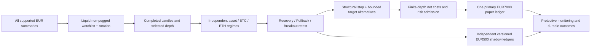

# Personal Plan V4.8 engineering and research report

V4.8 introduces an interpretable Regime-Adaptive Opportunity Engine (RAOE), broad EUR discovery, auditable plan construction and independent forward paper experiments. **Positive net expectancy is not demonstrated. The new playbooks were too inactive on the untouched test interval.** Engineering acceptance does not establish profitability or a completed 30-day trial.

Evidence: [full results](evidence/v4_8/research-results.json) · [registration](evidence/v4_8/research-registration.json) · [diagnostic snapshot](evidence/v4_8/audit-snapshot.json) · [engineering gates](evidence/v4_8/staging-readiness.json) · [synthetic Android-size screenshot](evidence/v4_8/raoe-radar-375.png).

## Root cause and evidence

The supplied earlier audit (1,392 decisions / 464 market evaluations, 29 technical candidates, zero economical candidates and zero orders) is development evidence. Its median modeled net reward/risk of about 0.556 and round-trip cost of about €2.93 support the economic rejection; the later rises in ENA/INJ/NEAR/BCH do not establish executable missed profit. The failed simple momentum experiment is retained as a caution against buying movement alone.

The archive was not located in the workspace. Read-only PostgreSQL exports of the current Aruba staging databases were restored locally for diagnostics, without importing them into the Mac financial account. This later snapshot contains 1,662 decisions across 14 markets, one €7,000 funding event, and zero orders, fills and positions. It has 42 technically eligible proposals; some later proposals pass the original economic calculation but still fail the reviewed quality wrapper. Its median net reward/risk is 0.5642, best 2.0189, median first-target net gain €3.1062, stop loss €5.5863 and cost €3.0207. These are different observation cutoffs, not a correction of the earlier audit.

The original A3/B3/E3 source, identities, parameters and old evidence remain unchanged. The V4.7.1 wrapper requires bullish hourly confirmation for A3/E3 and TP1 below nearby overhead. Those requirements are defensible continuation hypotheses but cannot represent every early recovery, and the overhead restriction can conflict with a breakout. The new hypotheses address those structures separately. No gate was reduced to force an order. Original Mac ENA/INJ losses remain outside this deployment and untouched.

## Architecture and economics

- Recovery requires consecutive completed strength, rising lows, a short-mean recovery and a local break; a bearish hourly EMA alone does not veto it. Extension and wick/range checks reject exhaustion.
- Pullback requires a bullish completed 15-minute structure, a meaningful retracement and a completed reaction below the prior high.
- Breakout retest requires a prior completed range break, an intervening hold and a later completed retest. Broken resistance is support; still-unbroken pivots cap runway.
- Regime dimensions cover emerging recovery, established trend, range, expansion, risk-off, liquidity stress and unknown data. Five-minute, 15-minute, hourly and four-hour aggregation excludes incomplete groups. Missing 4-hour warm-up is explicit unknown; it is not fabricated. Asset trend and synchronized BTC/ETH context remain separate.
- Stops use actual swing invalidation plus 0.25 ATR buffer and must remain at least one ATR from entry. Targets use confirmed pivots or the completed breakout range projection, capped at the next real overhead; targets are never raised to pass a threshold.
- Immediate entry is a fresh ask-side finite-depth IOC after a completed reaction. Patient prices retain the same structural stop, are recorded as alternatives and are not treated as fills. This release executes confirmed reactions in the primary runtime; patient-IOC alternatives are compared in research. No passive queue execution is claimed.
- Net reward/risk remains at least 1.2; first-target net gain must cover twice the modeled round-trip cost. Fees remain 10 bps and adverse slippage 8 bps per side in the prospective profile, explicitly conservative and unverified. Spread is represented once through bid/ask. Actual depth affects quantity/impact; future exit liquidity is an assumption. Partial exits must meet instrument minima.
- RAOE structural targets are bid-price scenarios. At the actual entry fill, the immutable exit plan converts them once to the broker’s minimum net-unit proceeds using the recorded exit fee/slippage and observed depth-impact assumption. The original supported bid targets remain in entry evidence and trade reports; actual net floors are shown separately. A regression executes a partial exit at that supported bid, then closes the remaining position protectively with full reconciliation. The earlier execution-model output is retained in `research-results-before-target-alignment.json`; all 72 fixed runs were repeated after alignment, with unchanged registered parameters and unchanged headline results.
- Fresh-book admission rechecks the exact immutable stop and targets under the financial lock, including costs, runway, partial minima and stop-risk limits. Entries cannot use an earlier qualifying spread after execution costs worsen.
- Estimated predictive edge is **UNKNOWN**, with no probability calibration, automatic promotion or performance-driven capital boost.

The existing risk caps are unchanged: €700 nominal position, €35 planned per-trade loss, €140 aggregate planned stop risk, €2,100 coarse correlated crypto exposure, €2,800 uncommitted reserve, six positions, €140 daily / €350 weekly loss limits and 10% drawdown halt. Shared account locking prevents duplicate exposure across playbooks; actual cash reservations remain authoritative.

## Chronological strategy research

The fixed February 1–15, 2025 Coinbase EUR proxy interval was registered before results were inspected. BTC/ETH/SOL contain 4,318 / 4,318 / 4,320 five-minute bars. Training is February 4–6, validation February 8–10 and untouched test February 12–15, with 24-hour purges and earlier warm-up. January 2025 and April–October 2026 were already examined and are not reused as independent proof. Twelve fixed variants across three segments and two cost scenarios produce all 72 runs below; no holdout tuning or winner promotion followed.

Each portfolio starts with independent simulated €500 and €75 nominal proposals, €5 planned stop risk, €150 reserve and three simultaneous positions. Normal fee/slippage/spread is 10/8/10 bps; stress is 15/12/20. Pricing, cost calculations, stop priority, partial targets, post-target trailing, position-specific causal discretionary exits and expiry use the same production functions/rules. Historical books are assumed finite levels based on 1% of the prior completed candle volume. Both-barrier candles use stop first. A target touch alone cannot imply passive execution. Database concurrency is tested separately.

| Strategy / entry | Train net € (closed) | Validation net € (closed) | Untouched net € (closed) | Stress untouched € (closed) |
|---|---:|---:|---:|---:|
| A3_COST_AWARE_CONTINUATION / completed setup | -3.63 (7) | -2.38 (5) | -0.55 (5) | -1.33 (2) |
| B3_STATEFUL_BREAKOUT / completed setup | -4.41 (6) | 0.00 (0) | -0.50 (1) | 0.00 (0) |
| E3_ADAPTIVE_RELATIVE_STRENGTH / completed setup | 0.00 (0) | 0.00 (0) | -0.76 (1) | 0.00 (0) |
| RAOE_EARLY_RECOVERY / completed setup | 0.00 (0) | 0.00 (0) | 0.00 (0) | 0.00 (0) |
| RAOE_TREND_PULLBACK / completed setup | 0.00 (0) | 0.00 (0) | 0.00 (0) | 0.00 (0) |
| RAOE_BREAKOUT_RETEST / completed setup | 0.00 (0) | -0.74 (1) | 0.00 (0) | 0.00 (0) |
| MOMENTUM_30M / completed setup | -28.97 (45) | -4.97 (42) | -23.06 (57) | -35.19 (59) |
| BUY_AND_HOLD / completed setup | -20.09 (2) | 4.38 (2) | -0.61 (1) | -1.13 (1) |
| CASH / completed setup | 0.00 (0) | 0.00 (0) | 0.00 (0) | 0.00 (0) |
| RAOE_EARLY_RECOVERY / patient IOC | 0.00 (0) | 0.00 (0) | 0.00 (0) | 0.00 (0) |
| RAOE_TREND_PULLBACK / patient IOC | 0.00 (0) | 0.00 (0) | 0.00 (0) | 0.00 (0) |
| RAOE_BREAKOUT_RETEST / patient IOC | 0.00 (0) | 0.00 (0) | 0.00 (0) | 0.00 (0) |

Every RAOE test variant has zero closed trades; none is labeled profitable. One normal-cost RAOE breakout validation trade loses about €0.745. Original A3/B3/E3 and the momentum baseline lose in the normal untouched interval. The buy-and-hold baseline buys only €75 per asset and leaves cash idle; thin assumed final depth leaves some marked exposure at segment end. Results explicitly disclose that exposure and include its mark in net equity; these are not all-flat realized returns.

Full results include gross return before modeled costs, fees, spread, slippage, fills, missed patient fills, rejection counts, drawdown, profit factor, expectancy, holding duration, regime and exit reasons. No reliable risk-adjusted statistic is claimed from this short dependent sample. Survivorship selection, a small asset set, no historical L2/queue, proxy prices, bar ordering and insufficient independent trades limit inference. Patient variants are too inactive. The fixed variants are preserved; the next study must get a new version and unused interval.

## Durable forward research and dashboard

The approved staging activation provisions six independent €500 ledgers: original A3/B3/E3 and the three RAOE playbooks. Each gets its own database, account marker, frozen source/parameter/cost manifest and exactly one independent funding event. Their cash is never added to the primary portfolio. They consume shared observations and protected books, and survive restarts with durable decisions and idempotent gateway keys. The source bounds active experiments to eight; no existing experiment is deleted to make room.

The Opportunity Radar shows ready/watching/rejected/stale/unscanned states, price and relative movement, regime, spread/turnover proxy, relative strength, playbook, entry/stop, planned loss and costs. Strategy Competition separates prospective primary attribution, independent shadow performance and historical proxy results. Original trade reports and corrected SELL attribution remain available. Android-size tables scroll within their panel, retain readable labels and never weaken authentication.

The ten-stage funnel distinguishes passed, failed, not reached and unknown. Immutable event records retain observations, original plan, gates and rejection. Events group the first strategy/asset observation in each half-hour; overlapping six-hour outcomes remain dependent. Separate future assessments use subsequent stored candles and stop-first ambiguity. Favorable paths are labeled **potential favorable move, not proven executable**. Missing coverage and inconclusive paths remain explicit. This initial review does not simulate every possible alternative hypothesis or claim passive fills.

## Infrastructure, identity and financial cutover

The PostgreSQL healthcheck now names the actual container-configured database instead of assuming `autotrader`. Read-only VPS logs confirm the monitoring KeyError at the experiment reconciliation projection during shadow creation; creating experiments now expose explicit NOT_CHECKED/UNKNOWN fields. No financial schema migration is introduced.

Revolut documentation checked on October 27, 2026 specifies one request per second for the relevant public families and Retry-After in milliseconds: [official API reference](https://developer.revolut.com/docs/api/revolut-x-crypto-exchange). Existing PostgreSQL rate reservations, shared completed-candle cache and local singleflight are retained. Endpoint-family gates prevent a slow history request from holding the protective book gate. Priorities are protection 0, execution 5 and routine observations 10. Backoff duration, 429s, requests, latency and cache metrics persist. Routine discovery uses one public ticker summary, excludes pegged assets and reserves one rotating least-recently-inspected slot; only shortlisted markets request books. Research remains a separate bounded process.

All source work stays on `feature/autotrader-v46-intelligent-opportunity-engine`; main and the old autotrader-v41 environment are untouched. V4.8 explicitly fails production preflight. The separate `deploy/staging.py` path requires an exact full commit, package/file hashes, successful engineering gates, Linux AMD64 image identity and installed-source verification. The user explicitly authorized this staging release without another routine approval.

Before activation the real current account must reconcile and new entries are paused while protection continues. A verified snapshot backup covers every registered database; all 19 financial table seals, account markers and single funding events are checked after isolated restoration. The candidate rehearses the explicit immutable profile revision on that restored account before actual cutover. Open positions or pending orders defer cutover without a force sale. The staging helper can wait up to two hours with entries paused and the old protection loop running; it rechecks reconciliation and fresh protective heartbeats before taking the final flat-account backup. A detached staging deployment service can carry this exact verified release through the wait without depending on the Mac staying awake. Origin markers, old profiles, original funding, fills and journal remain intact.

The retained PostgreSQL/Redis images and volumes, loopback ports 13000/18000, Tailscale Serve route, timers and prior rollback images are preserved. The deployment helper never invokes global prune, volume deletion or a financial database restore on the active system. If activation fails, it preserves private diagnostics, pauses entries and recovers previous application images against the current ledger for monitoring; it never rewinds newer transactions. A correction requires local testing and a separately verified release.

## Verification and release status

The complete backend suite passed **325 tests**; the final RAOE and real-audit diagnostic set passed **25 tests**. Ruff passed and mypy checked **120 source files**. Frontend production build/TypeScript passed, with **19 unit tests** and **11 browser checks** at 375/1440px. The final AMD64 set passed 65 of 66 cases initially; one stale synthetic-timestamp case then passed independently on the same image (66 covered cases pass in aggregate). After target alignment and the fresh-window fixture correction, the complete final installed-image AMD64 suite passed **all 69 tests**. The read-only dashboard projection also passed its focused tests. An earlier candidate Linux run passed all 64 cases. A later process fixture was built just before a five-minute boundary and correctly rejected as stale; the acceptance setup now waits for a fresh completed-bar window. The stale-data guard was not relaxed; the precise wall-clock/fixture-timing cause is not established. A merged Compose preflight caught and corrected YAML quoting in the new healthcheck before any remote activation. Final commit, image IDs and staging activation results are reported in the accompanying immutable release/deployment evidence. Source preparation is not a prospective-performance claim. The initial broad test run exposed three legacy NoopMarketClient failures after the new refresh hook, plus a missing synthetic replay-clock fixture. The refresh now applies to the real public client, and replay clocks are explicit; targeted regressions pass. Browser harnesses were updated for the new baseline-observation tab and readable status labels. Initial failed outputs are retained; final successful gates are reported separately.

The study and final image differ only in `api/v48.py`, a read-only lifecycle projection. [Per-module source proof](evidence/v4_8/research-code-proof.json) verifies every strategy, cost, accounting, exit and simulation module is identical.

## Next evaluation plan

Keep definitions frozen and gather genuine Revolut X prospective observations through several regimes. Review protection and reconciliation continuously; compare net results, loss causes, realized R, costs, rejected paths, missed fills, utilization, holding duration and regime/asset concentration weekly. Treat repeated signals and overlapping outcomes as dependent. Retain inactive and losing hypotheses. Propose a new version when evidence shows a structural issue; preregister fresh chronological comparisons before inspecting their test data. Do not infer calibrated probabilities from a few winners, call inactivity profitability, or automatically increase allocation. Real-money execution, authenticated exchange placement and live promotion remain disabled.
