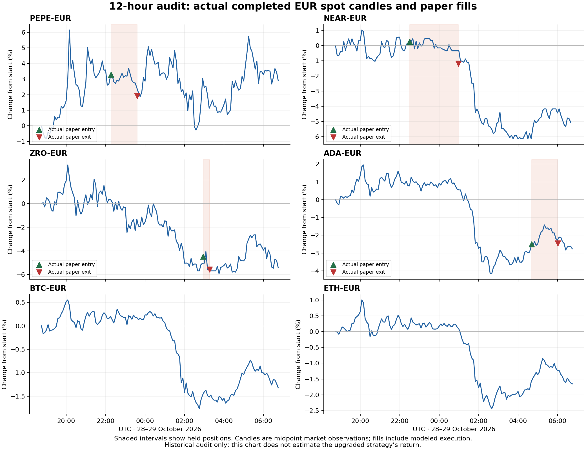

# V4.9.1 audit and primary admission upgrade

**Rollout status:** rc.1 passed both seventeen-account restore gates but failed its final opportunities-history endpoint check. The helper safely recovered the previous images, preserving cash/history with entries PAUSED. The API-only rc.2 correction is locally verified and requires separate exact-release approval. See [the rc.2 engineering report](V4_9_1_RC2_ENGINEERING_REPORT.md). The market audit and admission rules below are unchanged.

## Finding and scope

The primary paper account lost **€32.472721319668** across four closed positions in the fixed twelve-hour window **28 October 2026 18:47:54.205442 UTC to 29 October 2026 06:47:54.205442 UTC** (19:47 to 07:47 Europe/Rome). Gross price losses were €26.917691269324 and fees €5.555030050344. The flat account's cash moved from €6,994.086940919949 to €6,961.614219600281, a 0.4643% loss. There is one original €7,000 funding event, sixteen lifetime fills, and no reconciliation errors. No duplicate funding, real exchange order or missing cash explains these losses.

The running release at collection was V4.9.0-rc.2, commit `6ff510949259b3781cdda8aa22392d11939e08a2`, on Aruba staging only. Source, configuration and containers were not changed on the VPS during Stage A. All application changes originate locally on the existing development branch.

## What happened

| Asset / recipe | Entry → exit, UTC | Gross price P&L | Fees | Net P&L | Actual exit |
|---|---|---:|---:|---:|---|
| PEPE / trend pullback | 28 Oct 22:16 → 23:36 | −€9.330966 | €1.385712 | −€10.716679 | Stop |
| NEAR / A3 continuation | 28 Oct 22:30 → 29 Oct 00:58 | −€9.950606 | €1.384203 | −€11.334809 | Stop |
| ZRO / early recovery | 29 Oct 02:56 → 03:16 | −€7.974371 | €1.390627 | −€9.364998 | Local regime reversal |
| ADA / early recovery | 29 Oct 04:41 → 06:00 | +€0.338252 | €1.394487 | −€1.056235 | Local regime reversal |

The whole V4.9 profile had six closed losing positions, net −€41.917970958944. The earlier PEPE and ENA recovery positions lie outside this twelve-hour window and are not added to its loss. Four of those six trades lost before fees; two small gross gains were consumed by costs. This is a setup selection and timing problem with an additional cost burden, not evidence that removing fees or holding losing positions longer would fix the strategy.

### Market comparison

The actual Revolut EUR spot candles show a flat-to-rising evening followed by broad weakness after approximately 01:00 UTC. From the last completed close before the start to the last available completed close before the end, BTC fell 1.32%, ETH 1.65%, NEAR 5.05%, ZRO 5.43%, ADA 2.77%, and ENA 3.66%. PEPE rose **2.89%** overall but repeatedly reversed within the window. NEAR's last retained candle completed at 06:40; the other reported assets completed at 06:45. These endpoint returns are market context, not returns available to each trade.

An independent same-window check of genuine Binance futures candles through TraderSpy shows BTC −1.44%, ETH −1.86%, and 1000PEPE +3.01%, agreeing on direction. Sources: [BTC](https://traderspy.app/signals/token/BTC), [ETH](https://traderspy.app/signals/token/ETH), [PEPE](https://traderspy.app/signals/token/PEPE). Futures/USDT prices, liquidity, fees and FX differ from the app's spot/EUR execution. PEPE's futures contract represents 1,000 units; percentage returns are scale invariant. Current technical readings were also bearish but are not substituted for information known at entry.

### Entry-time diagnosis

1. **PEPE pullback bought weak micro momentum inside a higher trend.** Its recorded higher 15-minute/hourly/four-hour trends were bullish, and reconstructed BTC/ETH hourly trends were bullish. The latest local five-minute close was below EMA9. The higher trend and modeled payoff passed while the immediate reclaim failed. PEPE's positive twelve-hour return does not make this entry profitable: the held interval reversed, hit its stop, then recovered later. Stops remain necessary.
2. **NEAR exposed a specific admission clock defect.** The selected candle started at 22:20 and completed at 22:25. The order was admitted at 22:30:00.187, after the next candle had completed. The precomputed freshness flag was not revalidated against the locked broker clock. Its recorded A3 quality checks otherwise passed; reconstructed benchmark hourly trends were bullish. The new broker guard checks currentness again at both admission and pending dispatch, even if the order book is only one second old.
3. **ZRO and ADA bought short recoveries inside a declining higher context.** Their original evidence already recorded nonbullish local fifteen-minute/hourly context. Reconstructed completed BTC and ETH hourly trends were both bearish. The early-recovery recipe deliberately allowed an early turn, but a short bounce did not confirm a durable recovery. The new primary policy requires a completed fifteen-minute reclaim and a rising close, and rejects long admission while both completed hourly benchmarks are bearish.
4. **The review concealed useful distinctions.** Historical entry concerns were empty despite recorded bearish recovery context. A generic `MARKET_RISK` label obscured that ZRO/ADA exited on a local regime-reversal assessment. The review now exposes those recorded details without rewriting historical orders or changing exit semantics.

Planned stop risk is conditional on executable prices; fresh bid gaps, spread and finite depth can make realized stop loss larger. This release does not promise a hard stop-price guarantee, weaken protections, widen stops to hide losses, or increase risk budgets.

### Shadow comparison and dependence

The original raw A3 control closed six positions for −€3.911068336737 in the window and still held one position at the cutoff. The early-recovery control closed two for −€1.696869328825; pullback closed one for −€1.030211671857. Other current controls had no closes. Eight older archived ledgers remained stopped. Primary proposals were approximately €700, compared with approximately €75 proposals in €500 shadow ledgers; absolute P&L is not directly comparable. The raw A3 control also lacks the primary account's V4.7.1 quality gate.

The four primary positions form only three overlapping exposure windows, and all are correlated crypto longs. This is far too little independent evidence to estimate expectancy, claim statistical superiority, or infer that a new filter is profitable. The seven original forward controls retain their identities, funding, histories and behavior for continued comparison.

## Upgrade implemented

The plan in [V4_9_1_UPGRADE_PLAN.md](V4_9_1_UPGRADE_PLAN.md) was written before the guard replay. V4.9.1 adds a versioned **primary-only** admission policy using existing indicator periods:

- Require aligned, genuine, completed local and BTC/ETH history; unknown context fails closed.
- Revalidate that the signal is the currently completed five-minute candle at locked admission and pending dispatch.
- Block a long when both completed BTC and ETH hourly EMA9/21 trends are bearish.
- Require the asset's completed close above a nonfalling EMA9.
- For early recovery, also require the completed fifteen-minute close above EMA21 and above its previous close.

The new proof is separate from the original recipe and quality evidence. It cannot promote an originally rejected setup. Its policy version, identity, timestamps, finite inputs and strict Boolean gates are checked again under the broker lock. Missing, stale, forged or incomplete proofs fail closed. The dashboard explains which primary context condition blocked an entry.

The primary prospective profile becomes `4.9.1-paper.1`; base RAOE definitions remain V4.9.0. The shadow execution fingerprint remains exactly `44264f01586fedbd62e949f142c8240bb2dd9bae86c454fb17d388e2f5d9559c`. All six existing primary recipes, seven original shadow controls, fees, sizing limits, stops, exit behavior and official approval gates remain. No account is created, refilled, retired or deleted by this upgrade.

### Development replay is not strategy performance

The fixed guard rejects all six observed V4.9 losing entries in a completed-bar reconstruction. It also passes both earlier V4.7.1 entries, including a loser. **That is a development diagnostic, not a counterfactual P&L or an untouched validation result.** No rules were retuned after the replay.

Crucially, rejecting the original PEPE pullback can free capital/position capacity for the A3 PEPE proposals at **22:21:27 and 23:10:38**, which were originally rejected because a position already existed. Both proposals pass the new context guard. Their counterfactual fills, exits, costs and subsequent decision path are unproven. Simply adding the six blocked losses to account equity would be false. The release makes no avoided-loss, win-rate or profitability claim. Retrospectively reconstructed peer bars do not establish the first-observation timestamp of every bar; original saved entry evidence remains authoritative.

## Operational defect found during collection

The old diagnostic exporter aggregated whole signal histories into one PostgreSQL JSON object. With the expanded V4.9 evidence this exceeded the 512 MiB PostgreSQL memory limit. Logs contain an earlier occurrence at 05:35 UTC and an occurrence triggered by our first broad diagnostic at 06:42 UTC. The latter interrupted database connections and caused automatic backend/research process recovery. The collector was stopped; financial reconciliation, running paper processes and fresh position monitoring were verified after recovery. The current API returned its reconciled primary report in approximately 0.914 seconds, so no unrelated API latency defect is claimed.

The replacement uses read-only, bounded, row-by-row queries and a gzip stream; no large whole-history aggregate or remote output file is created. Large state payload omissions are explicit. A local memory-cap regression streams over 600 MiB from an isolated 512 MiB PostgreSQL instance without an OOM. The unsafe legacy entry point now fails before querying. Log samples are capped at 5,000 lines per service; worker/backend samples can be truncated and are not represented as complete twelve-hour logs.

## Evidence, financial preservation and release gates

Private local evidence contains the complete 49,162,472-byte compressed row stream, 9,303 genuine market candles, original entry/exit evidence and all seventeen fresh database exports with hashes and individual cutoffs. The row stream explicitly omits state payloads above 256 KiB. The initial bundle did not contain the official database's closed-bar first-seen cache; the report does not claim first-seen causality proof from the later candle export. Sanitized aggregate analysis and chart inputs are published in `docs/evidence/v4_9_1`; raw account dumps, credentials and detailed private logs are excluded from Git.

Original rc.1 Stage A results: **446 distinct native backend cases** (445 initial full-run passes plus the corrected legacy diagnostic case; six diagnostic and five updated deployment-helper cases rechecked), **441 installed Linux cases**, **19 frontend tests**, **24 Chromium/Nginx browser cases**, TypeScript/Vite builds, Ruff and mypy on 132 modules. Five Docker host orchestration/resource cases were excluded from Linux and passed natively. The full installed Linux run had zero failures, zero skips, and five explicit deselections. Final source hashes, original failure/correction provenance, installed API checks and the isolated seventeen-account financial rehearsal are recorded in nine source-bound gate JSON files and `staging-readiness.json`. A failed check never becomes a pass by omission. Engineering acceptance establishes preservation and enforcement behavior, not prospective market performance.

Stage B must use the exact reviewed immutable commit and Linux AMD64 images, fresh seventeen-database backup/restore verification, unchanged PostgreSQL/Redis volumes and Tailscale access, and a flat cutover under existing position protection. It must wait for open controls to close normally; it must not force sales or overwrite newer transactions with an older dump. The helper retains all fifteen shadow manifests and resumes the same seven compatible controls. It verifies new primary observations, paper-only execution, source/image identity and reconciliation before activation is accepted. Any failure stops activation and preserves diagnostics and rollback images.

The repository's [AGENTS.md](../AGENTS.md) requires approval of the completed exact release after Stage A and before Stage B. Generic prior deployment authorization does not satisfy that release-specific gate. Real-money trading and the old production server remain outside this release.
